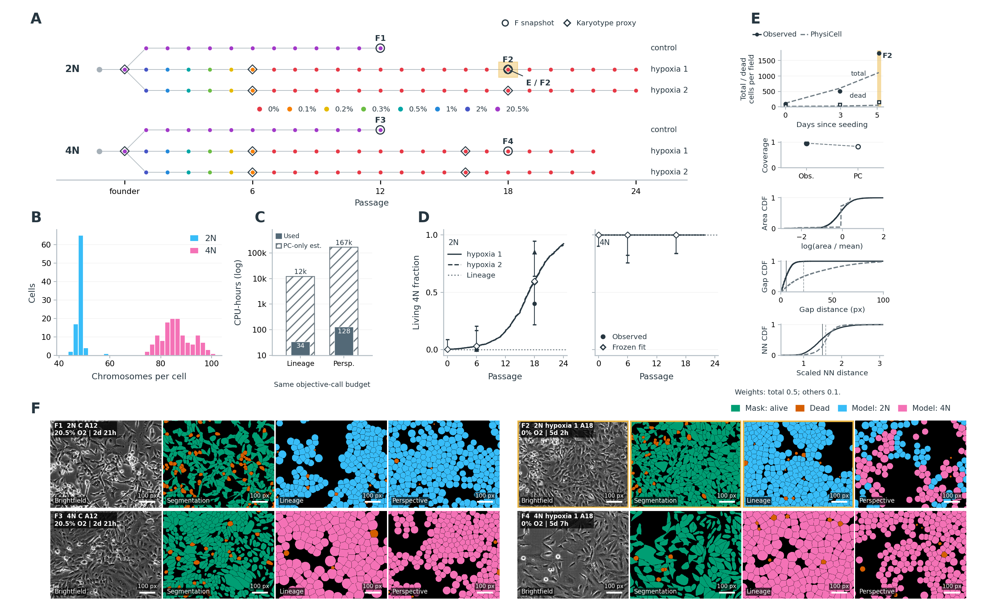

# cloneID agentic research workflows

This repository supports reproducible, agent-assisted research with cloneID data. It brings together the reusable workflows needed to
reconstruct cell-culture lineages from the cloneID database, connect those lineages to laboratory-notebook evidence, organize experimental
instances and protocols, and fit mechanistic cell-growth models.

The repository tracks reusable workflow code, Codex skills, example configuration and selected figures/text. Raw database snapshots,
derived measurements, the live laboratory-record knowledge base, full analysis runs and private provenance remain local.

**Checkpoint status:** both pilots are complete and the [figure and calibration text](docs/u01_calibration_draft/latest/calibration.md)
use those results. The first fresh attempt stopped at a restrictive parent-selection rule. The revised runner treats parent scarcity
and incomplete native evidence as reported limitations, increases parallel search breadth, and is being prepared for a new scratch run. See the [SUM-159 example](examples/sum159/README.md) for the outcome and the
[workflow](docs/workflow.md) for the fitting boundary and procedure.

<!-- baseline-calibration:start -->
<!-- Mirrored from docs/u01_calibration_draft/latest/calibration.md; keep text and legend synchronized. -->
## A study-specific model integrates imaging and molecular measurements.

We implemented a PhysiCell model and multimodal calibration workflow, piloted in SUM-159 progressive hypoxia and normoxic controls from 2N and 4N founders, with 343 microscopy acquisitions across 118 culture episodes and 220 single-cell chromosome counts (Fig. A,B). Two general baselines are considered: in the lineage-guided baseline, recorded lineage relationships define clone identity and parameter sharing, with ridge-coupled founder parameterizations held constant across arms and passages in this pilot. In the perspective-guided baseline, investigator-chosen accompanying data define states and parameter sharing; here chromosome-count clusters define current 2N/4N genomic states shared across founders and treatments. Pre-existing mixtures change through differential division and survival, without state transitions. Fits to prepared measurements use a two-stage workflow: an analytical approximation proposes candidate parameter sets, followed by PhysiCell evaluation and correction, bounded local refinement and independent validation (Fig. C–F). These fits provide mechanistic starting points for hypothesis-driven changes and refitting.



**A two-stage workflow calibrates spatial models against longitudinal SUM-159 observations.** **A,** Recorded lineage and oxygen histories, with chromosome-sampling proxies; the highlighted 2N hypoxia 1 A18 passage links to E and F2. Hypoxia 1 and hypoxia 2 denote the two separately propagated hypoxia branches from each 2N/4N founder, following the oxygen series shown in A. **B,** Pooled single-cell chromosome counts, colored by the two genomic-state clusters. **C,** Measured CPU use for approximation guided inference, versus hypothetical PhysiCell-only inference. **D,** Living 4N fractions under hypoxia, with hypoxia 1 and hypoxia 2 trajectories, molecular observations (circles) and Wilson 95% intervals, and the dotted Lineage-guided reference. **E,** A Lineage-guided model example of measurements and distributions entering the weighted cost: total retained live + dead count (0.5), and dead count, coverage, relative area, gap and Clark–Evans organization (0.1 each). Count comparisons average two seeds; spatial illustrations use one seed and four observed fields. **F,** Four matched acquisition groups, each showing brightfield, segmentation and both models in representative snapshots covering 25% of each full field. Gold frames link the observed field, segmentation and Lineage-guided simulation to E. Fitted statistics use full fields. Scale bars, 100 pixels. Segmentation colors indicate living (green) and dead (orange) cells; model colors indicate 2N (blue), 4N (pink) and dead (orange).
<!-- baseline-calibration:end -->

## High-level replication sequence

1. Populate `core_data/` with a local snapshot of the cloneID database.
2. Validate the snapshot and generate the cleaned metadata graph, coherent lineage spans, and availability manifests under `data/`.
3. Extract and compress the relevant laboratory notebooks.
4. Ingest the notebook and lineage evidence into the live instance/protocol database under `lab_records/instance_protocol_db/`.
5. Freeze the prepared measurements and experimental design, fit the lineage-determined and perspective-guided baselines, then evaluate
   hypothesis-driven changes against the chosen baseline.

Start with the [user guide](docs/skills.md) for encrypted snapshot setup, machine-local imaging paths, example requests and output locations.
See [snapshot publishing](docs/publishing.md), [imaging data guidance](docs/imaging-data.md) and the
[SUM-159 example](examples/sum159/README.md). Existing prepared data can be reused for fresh fitting without repeating raw reconstruction.

Detailed guidance, commands, validation rules, and interpretation notes are provided by the skills under `.codex/skills/`:

- `cloneid-database-data` covers core-data refresh, cleaned metadata, coherent spans and lineage interpretation.
- `ingest-lab-records` covers notebook compression, experimental evidence retrieval and construction of the instance/protocol database.
- `physicell-modeling` covers prepared-data baseline fitting, agreed model extensions, simulator scoring and reporting.

Imaging and segmentation inputs come only from **CellSegmentations**, including its subdirectories and per-cell feature products. On RED,
set `CELLSEGMENTATIONS_ROOT=/share/lab_crd/CellSegmentations`; on the workstation, set it to the local mount. The detailed recursive
manifest is distributed as an encrypted download, and its paths are relative to that root.

Encrypted snapshots are stored as GitHub Release attachments and served through the static download page. Snapshot files, encryption
passwords and plaintext data stay outside Git history; the repository tracks the packaging and publishing code.

## Instance/protocol database operating loop

The intended workflow for the live laboratory-record database is an iterative, human-reviewed loop. Run the bounded update runner against
`lab_records/instance_protocol_db/`; by default it performs ten serial ingestion turns using Terra with medium reasoning, then asks a
Sol/xhigh reviewer to save prioritized database-compliance recommendations under `lab_records/instance_protocol_db/compliance/`.

```bash
RUN_ID=$(date -u +%Y%m%dT%H%M%SZ)
python3 .codex/skills/ingest-lab-records/scripts/run-instance-update-test.py \
  --database lab_records/instance_protocol_db \
  --test-root "tmp/instance_protocol_update_${RUN_ID}"
```

Review both the resulting `compliance/*.md` recommendations and the current live database. A human should decide which recommendations are
sound, recording each decision in a disposition Markdown file (start with
`.codex/skills/ingest-lab-records/assets/compliance-disposition.template.md`). Do not treat the compliance review as an automatic change
request: it can make questionable recommendations, so human-in-the-loop judgment remains required.

To apply explicit human-approved recommendations before the next ten-turn ingestion run, supply both files. This adds one preliminary
Sol/xhigh disposition turn; it reads the two files, changes only recommendations explicitly approved in the disposition, validates the
database, and then starts the ordinary ingestion loop.

```bash
python3 .codex/skills/ingest-lab-records/scripts/run-instance-update-test.py \
  --database lab_records/instance_protocol_db \
  --test-root "tmp/instance_protocol_update_${RUN_ID}" \
  --previous-compliance-review lab_records/instance_protocol_db/compliance/<review>.md \
  --user-disposition lab_records/instance_protocol_db/compliance/<disposition>.md
```

Each run retains frozen before/after database copies, event logs, and validation output below its `--test-root`. The runner processes only
one queue item per turn; when the queue is empty, it seeds the longest never-resolved coherent span with at least four passaging-table
entries. Use `--minimum-passaging-entries` to adjust that threshold, and avoid concurrent runs against the live database.

### Current workflow gaps

- There is not yet a defined refresh-and-reingestion procedure for updated laboratory notebooks or newly arrived notebooks.
- There is not yet a defined refresh-and-reconciliation procedure for an updated cloneID snapshot and its regenerated lineage data.
- Compliance-review guidance may need refinement, either through clearer database guidelines or a more detailed reviewer prompt, before its
  recommendations can be relied on more broadly.

The former plan `plans/seed1_hypothesis_test_v3/plan.json` and associated hypothesis worker/reviewer workflows under `scripts/` are legacy
material, not current instructions.

## Local and generated state

- `core_data/`: local raw cloneID snapshot.
- `data/`: regenerated metadata, availability manifests, and analysis-ready lineage products. Reusable growth and spatial evidence is organized
  by biologically meaningful analysis group under `data/longitudinal_analysis/`; it is derived from the cleaned lineage layer and interpreted
  alongside the live laboratory-record database. Each hypothesis still selects its target set scientifically and keeps its audit, synthesis,
  figures, and downstream work in one run-local `hypothesis_tests/` folder.
- `lab_records/instance_protocol_db/`: live local experimental-instance and protocol knowledge base.
- `tmp/`, `dev/`, and `hypothesis_tests/`: temporary development work and run-specific outputs.

These paths are excluded from version control except for small README files that document their intended use.
