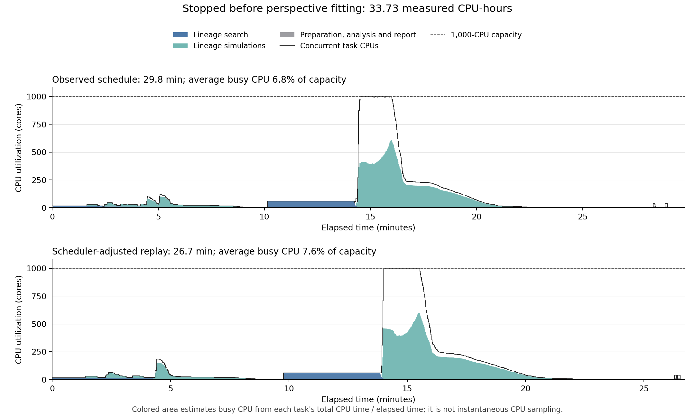

# SUM-159 baseline pilot

SUM-159 progressive hypoxia and normoxic controls provide a case study of the lineage-determined and perspective-guided baselines.
The two pilot fits are complete. This checkpoint retains their selected figure/text and reusable fitting procedure. The first scripted
fresh attempt completed lineage fitting, then stopped before perspective fitting because its competitive-parent prerequisite was unmet.

The prepared evidence covers 118 culture episodes, 343 microscopy acquisitions and 220 single-cell chromosome counts. Database
preparation and laboratory-record reconstruction establish the lineage, oxygen, seeding and measurement histories. The current fresh-fit
boundary begins with those prepared measurements and curated design; it does not repeat raw reconstruction.

## Models and retained results

The lineage baseline shares biology according to founding lineage: a shared fit is followed by two founder-specific parameter vectors
coupled by ridge, held constant across arms and passages. The perspective baseline instead shares biology according to current 2N/4N
genomic state across founders and treatments. Pre-existing mixtures change through differential division and survival without state
transitions. These are general ways of defining identity; SUM-159, hypoxia and two genomic states belong to this example.

The concluded local campaigns are:

- `20261016_180145_sum159_total_count_shared_ridge`: accepted lineage candidate `ridge_0100_10` on the pooled alpha-100 path, with
  native microscopy loss 9.2971.
- `20261016_190611_sum159_total_count_latent_state`: selected refined perspective candidate at alpha 0, with native microscopy
  loss 10.7331. Its retained physical vector and fitted mixtures supply the displayed fields and trajectory.

The perspective evaluation covers all 472 ordinary fields, including all 343 microscopy acquisitions with four seeds; 127/128 minority
probes completed. A separate composition recheck shifts fractions by up to 8.27 percentage points. Microscopy was not rerun at those
shifted mixtures, so combining its image score with the rechecked assay score gives a conditional diagnostic rather than a
self-consistent joint score. The figure uses the matching frozen fitted mixtures. This limitation is retained with the accepted fit.

| Recorded campaign | Measured CPU-hours | Elapsed minutes |
| --- | ---: | ---: |
| Lineage | 34.0 | about 40 |
| Perspective | 128.4 | about 31 |

These are the recorded pilot scheduler scopes, including their recorded attempts. Local preparation and reporting are outside those
totals. These are pilot measurements; the first fresh attempt is recorded separately below.

The [figure](../../docs/u01_calibration_draft/latest/baseline_multipanel.png),
[calibration text](../../docs/u01_calibration_draft/latest/calibration.md) and
[figure source notes](../../docs/u01_calibration_draft/latest/README.md) describe the selected results. The compact figure illustrates
lineage/assay evidence, compute use, clonal trajectories, six cost components and matched fields. Representative crops cover 25% of each
displayed field; fitted count/spatial statistics use full fields. Rebuilding it requires the named local pilot outputs and the private
prepared display/provenance assets specified by its builder.

## First fresh attempt

`20261016_205952_sum159_baseline_scratch` used prepared data, fresh parameter starts and the original 1,000-CPU campaign cap.
All 16 shared and 60 founder-specific fits ran, with 2,176 native attempts; 7 shared and 42 founder-specific candidates had complete,
finite native scores. The alpha-100 pooled selection had native loss 11.7122, compared with 9.2971 for the accepted lineage pilot.
Its vector was fitted at alpha 10 and selected when evaluated at alpha 100; fitting strength and pooled evaluation remain distinct.

The original perspective preparation required two shared parents within 20% of the best native loss. The best scored 12.9431, giving a cutoff of
15.5318; the next fully supported shared candidate scored 19.6005. Only one qualified. The original procedure stopped here, without
perspective optimization or validation. Its cutoff, starts and budget were unchanged. The complete fresh workflow remains undemonstrated,
and the multipanel retains the accepted pilots.

The stopped attempt used 33.7289 CPU-hours, plus 0.0036 for the separate runtime preflight. From the first campaign task, its observed
span was 29.80 minutes; the scheduler-adjusted replay takes 26.72 minutes. Estimated mean busy use in that replay is 75.75 cores,
or 7.57% of the 1,000-CPU cap. These measurements cover the stopped attempt and omit the unexecuted perspective search and validation.
All 9,701 planned slots reconcile: 2,333 completed workers, 86 failed workers and 7,282 cancelled before starting, with zero CPU use.
Scientific validity is checked separately from worker completion.



The [PDF](scratch_cpu_utilization.pdf) and [plot source](plot_cpu_utilization.py) accompany the figure. Colored areas estimate busy CPU
by distributing each task's measured CPU time across its elapsed interval; instantaneous CPU activity was not sampled. The replay
removes scheduler resource waiting and dependency polling while preserving the original cap, measured task durations, scientific
dependencies, serial stages and long tails. It preserves failed work and does not invent the unrun stages.

The stopped run was erased before the authorized restart. Its published accounting summary and figure are retained as historical
evidence; detailed run products were not backed up. For a retained run, the same plotting command reads saved accounting without fitting,
simulation or scheduler contact:

```bash
python examples/sum159/plot_cpu_utilization.py --run hypothesis_tests/<retained_run>
```

## Plan a fresh fit

[baseline.json](baseline.json) configures the new runner; the
[modelling procedure](../../.codex/skills/physicell-modeling/references/prepared-baselines.md) documents its selection and stopping rules.
Fresh shared and ridge lineage fits precede the perspective search. Perspective parents come from that same new run; competitive shared
fits are preferred, with other valid current-run parents filling scarcity. A single valid parent is sufficient. Partial-native,
approximation and fresh-design fallbacks are labelled explicitly and checked for valid embedding. Historical fitted vectors and the
founder-ridge winner are not used as perspective parents.

The restart uses 512 shared starts, 100 founder-specific starts at each of five ridge strengths, 1,000 perspective exploratory starts
and eight 100-second local refinement starts per eligible source. Native simulations, candidate scoring and parent embedding run in
parallel as their prerequisites finish, sharing one 1,000-CPU cap. Long 0% oxygen cases receive scheduling priority. Brief input checks
and reporting retain small allocations. Aggregate stage deadlines are disabled so queue waiting cannot exhaust scientific work;
individual engine timeouts remain. Planning estimates are about 513 CPU-hours and 68–85 minutes before external queue delays, including
additional refinement breadth; these are estimates, not a CPU-hour or wall-time cap. Replacement run
`20261017_152845_sum159_baseline_scratch` passed preflight and launched on 2026-10-17, then was canceled after home storage rejected
writes during ridge evaluation. All 512 shared and 500 ridge fits completed. The shared stage had 238 fully supported candidates and
best native loss 8.7152; ridge validation was incomplete and perspective fitting had not started. Total measured use was 203.0114
CPU-hours including preflight and storage recovery. Compact parameters, scores, source/input identities and accounting are retained;
bulk fields and external copies are being reclaimed. The expansion above describes that canceled attempt, not an accepted full fit.

The replacement workflow must obey [AGENTS.md](../../AGENTS.md): 50 GB durable storage, 100 GB transient peak across every volume, and
up to 1,000 cores for one hour. It is being changed to measure bounded native frames as they arrive, discard unselected raw output and
retain only compact evidence plus the selected report fields. A new run starts from prepared data and fresh parameters. It will not
reuse the canceled run's fitted vectors. Its final plan and source identity will be recorded before launch.

Poor fits, missing native cases and scarce screen/finalist pools produce a result with explicit limitations rather than stopping solely
on quality or coverage. Fully supported scores rank ahead of partial evidence, and partial losses are compared only on matching support.
Finalists remain distinct sources. The report distinguishes terminal-fit availability, validation completeness and complete scientific
evidence; accounting completion alone never establishes scientific completion.

Use an existing Python environment with numpy, scipy, numba, pandas, scikit-image, matplotlib and plotly. Provide the local prepared-data
directory and compatible lineage/perspective engine executables through configuration or `BASELINES_PREPARED_DATA`,
`BASELINES_LINEAGE_ENGINE` and `BASELINES_PERSPECTIVE_ENGINE`. Configuration-relative paths resolve from this example directory; local
output locations can be set with `BASELINES_OUTPUT_ROOT` and `BASELINES_SCRATCH_ROOT`. No prepared measurements or engine binaries are
bundled in Git. Raw imaging access, if separately requested, must use `CELLSEGMENTATIONS_ROOT`.

The prepared directory contains `observations.csv`, `observations.npz`, `field_measurements.csv`, `metadata.json`, `episodes.json`,
`assays.json`, `lineage_edges.csv`, `schedule_all.csv` and `excluded_schedule.csv`. Preserve their identities and units. The 30-column
observer weights total retained live + dead count at 0.5 and dead count, coverage, relative area, gap and Clark-Evans organization at
0.1 each; the older generic 29-column observer is different.

From the repository root:

```bash
# Synthetic pipeline checks, requiring no prepared measurements or engine execution:
python scripts/run_baselines.py mock --config examples/sum159/baseline.json --output tmp/baseline_mock

# Inspect the configured real-data plan after restoring local prerequisites:
python scripts/run_baselines.py dry-run --config examples/sum159/baseline.json --output tmp/baselines/planning

# Check execution readiness separately:
python scripts/run_baselines.py preflight --config examples/sum159/baseline.json
```

The example disables scientific execution. `dry-run` writes a plan without fitting, simulation or scheduler contact; `preflight` reports
the remaining readiness requirements. Synthetic checks validate software behavior, not scientific fit quality. An authorized run freezes
inputs/configuration, executes the bounded screen/refinement/independent-validation procedure, reports diagnostics and accepts the
fit for now. Further testing on an alternative lineage follows that demonstration.

Compact run records, prepared measurements and private provenance remain local; expendable raw simulation output is removed. The reusable runner/configuration and selected figure/text
are tracked; encrypted local-data snapshots are handled through the repository's [publishing workflow](../../docs/publishing.md).
